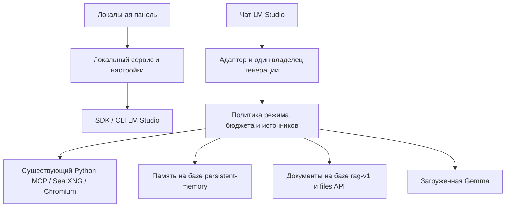

# Проектное решение

Дата: 2026-10-29. Основная архитектура остаётся предложением. Реализован автономный read-only советник 0.1.0 на Windows Forms/PowerShell; срез и его отличия от общей архитектуры описаны в docs/plans/01a-advisor-mvp.md. Начат этап 00: созданы общие контракты со схемами, read-only диагностика и чистая функция выбора интеграции. [Отчёт](research/capability-report.md) выбирает tools-only; адаптер генерации и общая панель ещё не реализованы.

## Задача

Пользователь работает в LM Studio с Gemma 4 12B и 26B MoE и хочет обычные понятные действия вместо настройки множества плагинов и знания имён инструментов. Сохранить существующий поиск, чтение и визуальный анализ веба; сделать понятными профили, Thinking, память и документы.

Среда текущей установки: Windows, i5-12400, RTX 4060 Ti 16 ГБ, 32 ГБ RAM, Docker Desktop; LM Studio 0.4.26, API `http://127.0.0.1:1234`. Проверенные исходники плагинов перечислены в CURRENT-STATE.md. Это исходные условия, а не требование навсегда поддерживать только одну модель.

## Объём

- Включены пункты пользователя 1, 2, 3, 4, 6 при условии понятного интерфейса.
- Голос полностью исключён: никаких микрофона, STT, VAD, TTS, голосовых моделей и кнопок.
- Нового захвата рабочего стола в текущем плане нет. Если он потребуется, это отдельная задача. Просмотр публичных веб-страниц и изображений остаётся.
- Пункт 7, снятие отказов и смена весов ради него исключены.
- Hub-публикация, новый чат-клиент, автоматическое обучение весов, обещание мгновенного 256К и изменение встроенного каталога моделей исключены.

## Рассмотренные подходы

| Подход | Достоинство | Ограничение | Решение |
|---|---|---|---|
| Только нативный плагин с настройками и статусами | Минимум новых окон | Нет проверенного API произвольного интерфейса для редактируемых списков и библиотек | Использовать для быстрых настроек, не обещать полноценную панель |
| Локальная панель + адаптер LM Studio + существующий веб-MCP | Можно объяснять и редактировать память, документы и профили; чат остаётся привычным | Нужен небольшой локальный процесс и комплект установки | Предложение автора по умолчанию, не выдавать за уже одобренный пользователем UI |
| Отдельный чат-клиент | Полный контроль генерации и интерфейса | Дублирует LM Studio и меняет привычный рабочий процесс | Не включать |

Планирование панели разрешено запросом на user-friendly проект. До продуктовой разработки этап 00 должен доказать способ подключения. Нельзя считать, что MCP сам перехватывает ответы или что второй Generator автоматически совместим с первым.

## Как это выглядит для пользователя

Одна локальная панель «LM Studio Companion», открываемая ярлыком. Четыре основных раздела и общая строка состояния:

- **Модель:** выбранная модель, «Подобрать настройки», профили «Повседневный / Работа с источниками / Свой», оценка памяти и измеренная скорость отдельно. Применение требующего перезагрузки профиля — явная кнопка после текущего ответа.
- **Ответы:** «Быстро / Авто / Подробно». Пояснение «Выбран подробный режим: задача с несколькими источниками». Непроверенный автоматический режим недоступен с понятной причиной.
- **Память:** «Что модель обо мне знает», фильтр «Общее / Проект / Временно», добавление и исправление записи, удаление, экспорт, заметный индикатор «Использовано 3 записи». На старте автоматическое сохранение новых фактов выключено; пользователь может выбрать «Предлагать сохранить».
- **Документы:** добавить файл или папку, выбрать библиотеку, увидеть «Обрабатывается / Готово / Требует обновления / Не прочитано», открыть найденный фрагмент с указанием файла. Исходные файлы не редактируются.
- **Состояние:** «Интернет доступен / Поиск недоступен / Источник заблокирован», что было сделано, ограничения и кнопка подробностей. Не показывать стек и внутренние имена функций в основном сценарии.

В чате пользователь пишет «Посмотри эту статью: URL», «Что нового в…», «Что на фотографии?» или «Найди в моих документах…». Имена `read_page` и других функций остаются внутренней реализацией.

## Архитектура и границы

Созданы `packages/core` (контракты и схемы), `packages/host` (консольная диагностика, пока без management-сервера) и `packages/lmstudio-plugin` (только выбор режима по отчёту, без регистрации hooks). Также существуют `packages/web-tools`, копия прежнего инструмента, и `packages/advisor`, автономный советник 0.1.0. Будущие директории: `packages/control-panel` — интерфейс; `packages/memory` — совместимый fork/адаптер памяти; `packages/documents` — адаптер RAG.

Технологический выбор автора: TypeScript для SDK/сервиса и браузерной панели, React + Vite для будущей панели, Vitest для TS; Python 3.12+, pytest и существующий Docker для веба. Не устанавливать Electron/Tauri и отдельную LLM для классификации в первом выпуске. Для первого среза 00 закреплены TypeScript 5.9.3, Vitest 3.2.7 и Zod 3.25.76 в package.json/package-lock.json; SDK пока исследуется из установленной версии 1.5.0 и не импортируется продуктовой диагностикой. Зависимости следующих модулей закреплять по мере проверки.

### Один владелец генерации

Сначала проверить расширение/адаптацию текущего `context-compressor`. Если публичного расширения недостаточно — рассмотреть отдельный fork с его сохранённой логикой и лицензией либо отдельный режим, явно заменяющий текущий обработчик. Одновременное владение ответом двух обработчиков запрещено. Пользователь не должен заново подключать все MCP-инструменты.

### Память

Переиспользовать смысл записей, категории, области и доступные алгоритмы persistent-memory. Публичного management API для полной панели в прочитанных исходниках не найдено: запланирован совместимый fork либо расширение владельца БД. Не подключаться к живому sql.js-файлу как второму писателю: плагин держит БД в памяти и сохраняет целиком.

Миграция существующих данных добровольная и однократная после остановки старого владельца: backup, чтение совместимой схемы, импорт, проверка количества и полей, переключение, возможность вернуть исходник. Не менять старую БД на этапе исследования. Фоновое извлечение фактов не должно конкурировать с ответом при Parallel=1; в первом выпуске предпочтительны явное сохранение и предложения после завершения ответа.

Проект закрепляется за чатом при первом управляемом ходе; выбор другого проекта в панели задаёт значение только для нового чата. Продолжать прежний чат под новым проектом нельзя: его история и сжатые summaries уже могли содержать проектные факты. Для смены предлагается новый чат, старый не переписывается. Этап 00 должен подтвердить стабильную идентификацию чата. Если её нет, автоматическая проектная и временная подстановка недоступна; нельзя угадывать принадлежность чата по последнему выбранному проекту.

Временная память нового приложения означает «только для этого чата, до перезапуска Companion». Она отделена случайным sessionId на пару chatScopeId/запуск host, живёт только в RAM и очищается вручную либо при завершении host. Закрытие LM Studio само по себе не обещает очистку, если Companion продолжает работать; это написано рядом с выбором области. Временные записи старого плагина не мигрируются. Общая память сохраняет сквозное действие между чатами.

Решение пользователя от 2026-10-29: ручные исправления памяти имеют приоритет над автоматическим извлечением и старой перепиской. Поздний результат фоновой операции не отменяет правку и не восстанавливает старую формулировку отдельной активной записью. Новое противоречащее сведение предлагается на подтверждение; до подтверждения действует ручная правка. Это правило управляемого хранения и подстановки: старые сообщения и summaries не переписываются, точность любого ответа модели не гарантируется.

### Документы

Переиспользовать `files.parseDocument`, `files.retrieve`, native citations и поведение rag-v1. Прикреплённые к чату файлы — первый результат. Постоянные библиотеки папок — следующий результат только после проверки загрузки FileHandle, индексации и жизненного цикла файлов в SDK. Не обещать готовый API папок, которого исходники rag-v1 не показывают.

Пользователь подтвердил два сценария: автоматически подобрать фрагменты по вопросу либо изучить указанные им файлы, главы, страницы или разделы. Явный выбор задаёт область поиска и имеет приоритет; автоматический подбор выполняется внутри неё. Выбор страницы доступен только при наличии реальных метаданных парсера. Если материал изучен частично, показывать границы чтения и пропуски. Для просьбы проверить весь документ при невозможности полного охвата предлагать разбор по частям, не объявляя проверку завершённой.

### Приоритет материалов при нехватке контекста

Порядок подтверждён пользователем: сначала материалы текущего запроса (явно выбранные документы, изображения и URL), затем важные закреплённые предпочтения, затем дополнительные результаты поиска и обычные записи памяти. Место под ответ резервируется заранее; старую переписку при необходимости сокращать через совместимый механизм context-compressor. Явный выбор пользователя не отменяет ограничения окна и не разрешает скрыто пропускать выбранные материалы.

При сокращении материалов сообщать, какие части не вошли в запрос модели. Недостаток места не означает отсутствие данных в источнике. В режиме «только по документам» отсутствие переданных модели доказательств останавливает содержательный ответ по документам с объяснением причины; ограничения tools-only сохраняются.

### Веб и проверяемость

Разделять выбранный инструмент, физическое выполнение и полученные данные. Полезный текст и описание CAPTCHA — разные результаты. После 403 не делать зрительный запрос просто ради обхода запрета. Для доступной, но плохо извлечённой страницы допустим один визуальный fallback; vision-ответ — интерпретация модели, не точная цитата текста.

Доступность source_id доказывает существование записи источника, но не соответствие утверждения тексту. Полная автоматическая проверка всех фактов не обещана. Гарантируется только детерминированный отказ от утверждения «страница прочитана», если чтения не было; это реализуется контролем вывода при наличии владельца генерации. В режиме только MCP — лишь явные статусы и инструкции, без такой гарантии.

## Общие контракты для будущей реализации

В `packages/core/src/contracts.ts` определить и проверить схемами:

- `CapabilityReport`: `lmStudioVersion: string`, `checkedAt: string`, `features: Record<string, {state: 'verified'|'unsupported'|'unknown'; evidence: string}>`.
- `TurnContext`: `turnId: string`, `chatScopeId: string|null`, `sessionId: string|null`, `projectId: string|null`, `mode: 'fast'|'auto'|'deep'`, `signal: AbortSignal`. chatScopeId — проверенный стабильный ID чата, projectId — его неизменяемая привязка, sessionId — временная область данного чата в текущем запуске host. При отсутствии подтверждённого chatScopeId проектная и временная подстановка выключены.
- `OperationResult<T>`: `{ok: true; value: T; warnings: string[]}` или `{ok: false; code: string; message: string; retryable: boolean}`.
- `SourceRecord`: `id`, `turnId`, `uri`, `title`, `kind: 'web_text'|'web_visual'|'document'`, `status: 'ok'|'partial'|'blocked'|'empty'|'timeout'|'error'`, `retrievedAt`, `contentHash: string|null`, `chunks: {id: string; text: string; locator: string}[]`. Сигнатура `registerSource(turnId: string, record: Omit<SourceRecord,'id'|'turnId'>): SourceRecord`; ID выдаёт реестр, а не модель.
- `TurnBudget`: `maxQueries: number`, `maxPages: number`, `maxRepairs: number`, `deadlineMs: number`. По умолчанию обычный поиск: 3 запроса, 5 страниц, 1 исправление, 120000 мс; исследование: до 10 запросов, 12 страниц, 1 исправление, 300000 мс. Это потолки, а не обязанность расходовать всё. Отмена и токенный бюджет могут завершить работу раньше.
- `UiNotice`: `level: 'info'|'warning'|'error'`, `message: string`, `operationId: string`; подробности отдельно и без секретов.

Денежных/API облачных зависимостей не добавлять. Интернет нужен только для выбранных веб-действий и установки зависимостей; поиск передаёт запросы сайтам и поисковикам, это видно в справке.

## Общие ограничения

1. Целевая система первого выпуска: Windows, локальный LM Studio; тексты интерфейса на русском.
2. Чат остаётся в LM Studio; отдельный чат-клиент не разрабатывать.
3. Один владелец генерации; совместимость с context-compressor проверять до включения автоматики.
4. Новая панель и management API слушают только loopback; случайный локальный токен, проверка Origin/Host и защита изменяющих запросов. Файлы выбираются через разрешённые корни, не произвольный URL-путь.
5. Один писатель для памяти; резервная копия перед импортом/миграцией; старые чаты не переписывать.
6. Все фоновые операции отменяемы; при Parallel=1 фоновая LLM-работа выполняется после основного ответа без вложенного ожидания самой себя.
7. Модель не перезагружать посреди ответа; оценки и замеры показывать раздельно.
8. После неуспеха источника не утверждать, что он прочитан; source_id не является доказательством истинности факта.
9. Голос и пункт 7 исключены; захват рабочего стола отложен.
10. Секреты, memory.db, чаты и пользовательские документы не включать в исходники и отчёты.

## Когда дизайн можно реализовывать

После этапа 00 должен быть отчёт с подтверждённым способом работы панели, адаптера генерации, Thinking и FileHandle. Неподтверждённые функции остаются недоступны с объяснением. В первую очередь выпускать полезные независимо проверяемые улучшения веба и памяти; не задерживать их ради неподтверждённого автоматического Thinking.
